# Homelab-setup
For this setup; I'm repurposing an old Dell Desktop into a Debian server that'll host Proxmox VE.

Proxmox VE is a free, open-source platform that can run and manage Virtual Machines (VMs) and Containers. You can access it via Web-browser, so I can build from my home computer. For my project, I'm planning to use VMs to simulate a small-scale network for Cybersecurity testing. Additionally, I'll use a container to host tailscale so I can SSH into my machine if I'm away from home.

## Proxmox-setup
After installing Debian onto my host machine, I'll be referring to Proxmox documentation for setup: https://pve.proxmox.com/wiki/Install_Proxmox_VE_on_Debian_13_Trixie

The setup is straightforward, you can just copy and paste the commands into your terminal.

The first step is to change the host machine's loopback address. Here I've replaced 127.0.1.1 with the IP address of my host machine.
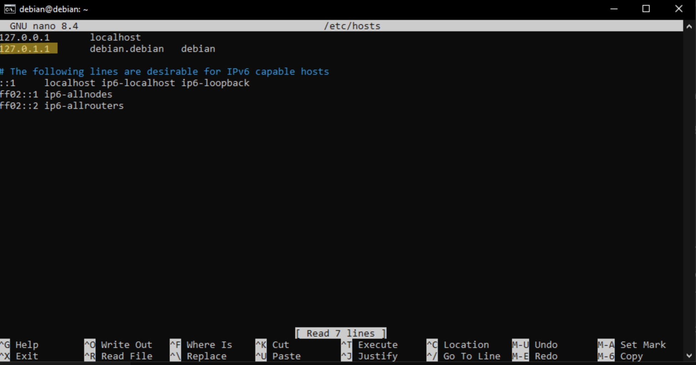

Next, we have to add the repository sources, then check it's correctly configured with:

nano /etc/apt/sources.list.d/pve-install-repo.sources
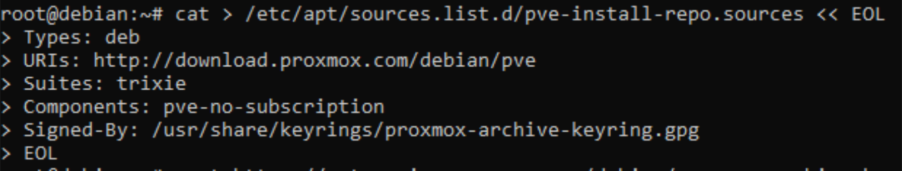
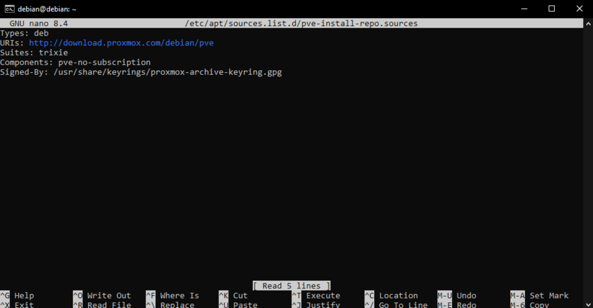

Everything looks okay, so next we add the repo key as a root user.
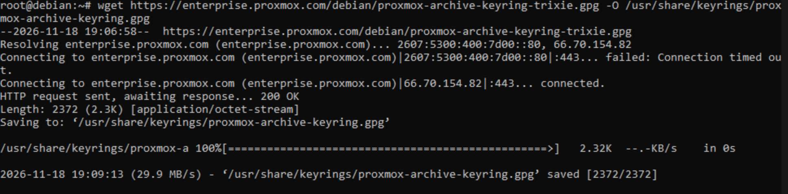

Next, I've issued the 'apt modernize-sources' command to migrate pre-existing repositories into the deb822 format. 

Once it's migrated, the 'apt update && apt full-upgrade' will refresh the list of available packages and update them.
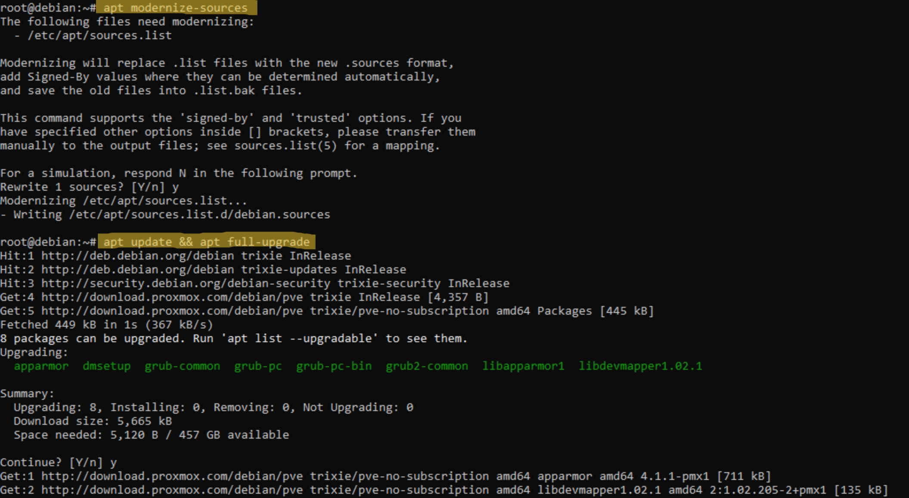 
##### Note: This isn't necessary as the old entries still work for now, but still considered good practice.

Here we will install the Proxmox VE kernel and reboot the system to ensure everything is working properly.
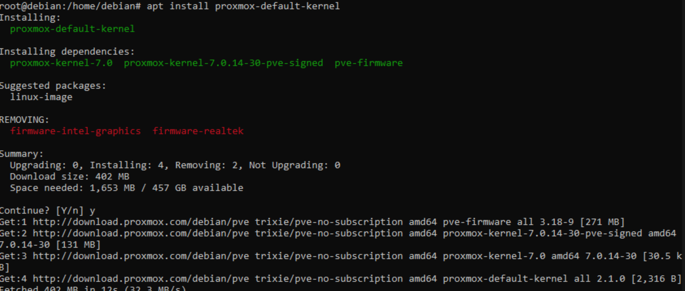
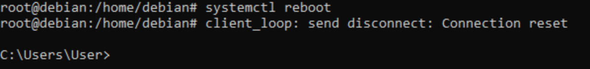

Now you can install the Proxmox VE packages via 'apt install proxmox-ve postfix open-iscsi chrony'
This will prompt if you'd like to install a mail server. For my case, I don't need it so I'll input 'no configuration'
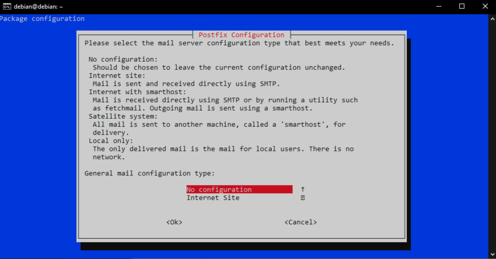

After some time, the system will install all the necessary discrepancies and reboot.

Now you must remove the Debian kernel. 
Proxmox VE uses it's own kernel that'll interfere will Debian on upgrades.

You can do that by using the ' apt remove linux-image-amd64 'linux-image-6.12*' ' command.
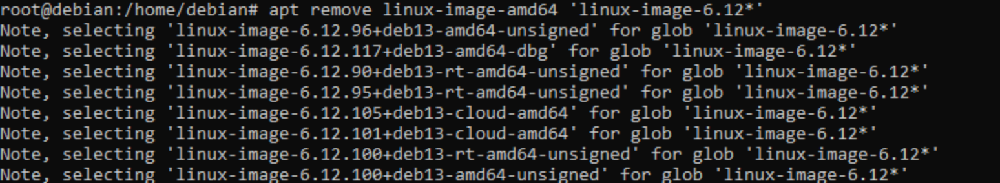

Once you've removed the kernel, Proxmox should be up and running.

You can access the Web GUI by inserting the host machines IP address followed by it's port.
##### For example: X.X.X.X:8006

You'll be met with a security warning (which is normal), simply click on proceed to wesbite.

The first thing to pop-up is a box, urging you to use a subscription. The subscription isn't mandatory, and later on I will show you how to disable this box from showing up again.

After that, a login screen will appear, there you insert your machines login credentials.
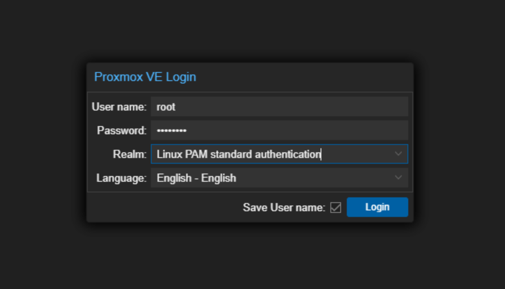

The documentation suggests creating a Linux bridge named "vmbr0". This allows your VMs and Containers to connect to the network. Without it, only the host can access the physical network port.

Here I've issued the 'nano /etc/network/interfaces' to manually change the interfaces, creating a bridge.
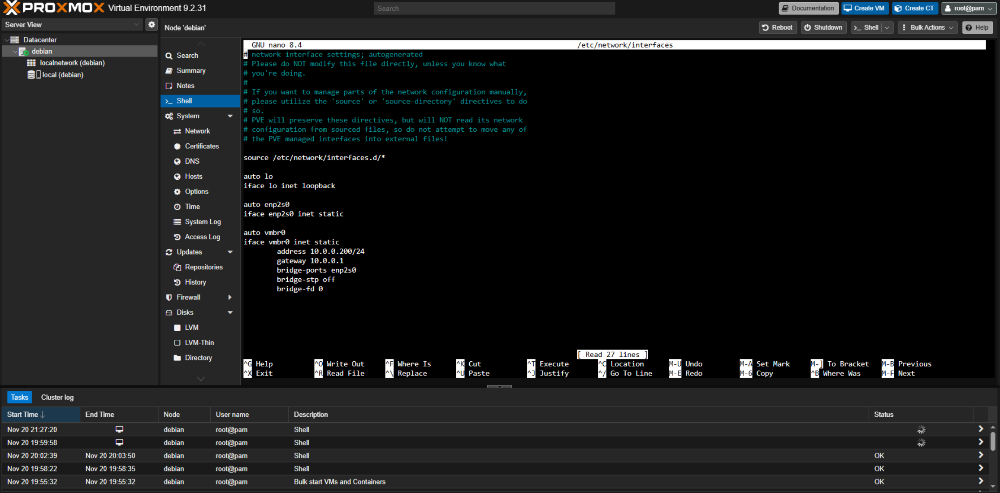

To ensure proper post-installation cleanup, I'm using a community-made script to automate this process for me.

However, first I'd have to configure DNS on my machine as my environment wouldn't be able to recognize the command I've pasted.

To configure DNS, I'll issue the 'nano /etc/resolv.conf' command, where I'll use Google and Cloudflare's public DNS servers.
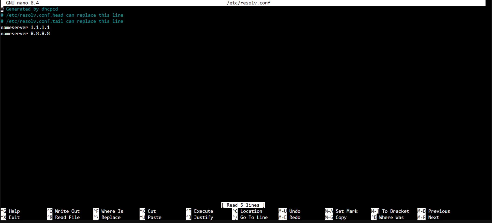

Now that my machine can resolve the domain address, I can copy and paste the script:

bash -c "$(curl -fsSL https://raw.githubusercontent.com/community-scripts/ProxmoxVE/main/tools/pve/post-pve-install.sh)"
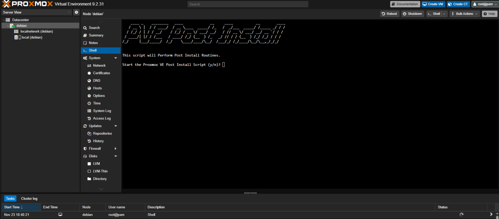

The 'pve-enterprise' repository is used for a production environment. This is a paid subscription, but the packages in this repository go through extra testing/stabilization before release. Making it less likely that something will break on a server that matters. For personal/testing use cases it's not necessary, hence why I've selected to keep the 'pve-no-subscription' repository, which is free.

Disabling the 'subscription nag' simply gets rid of the message at startup, urging you to use a valid subscription.
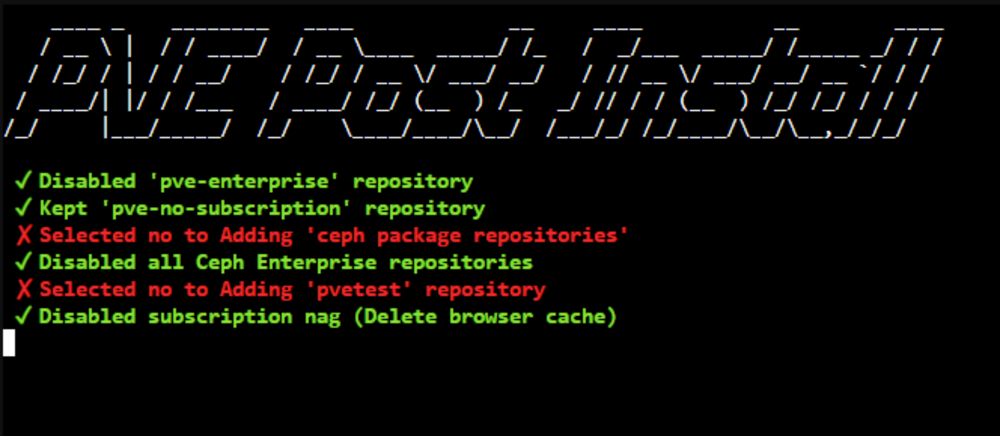

High availability is used for an environment that has multiple Promox nodes. Because I am only using one instance, I will disable this.
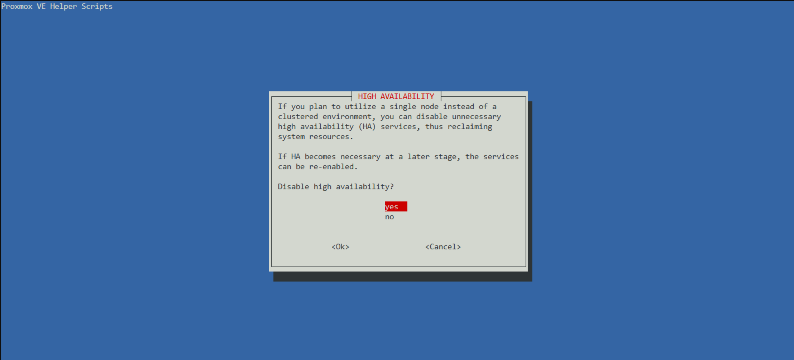
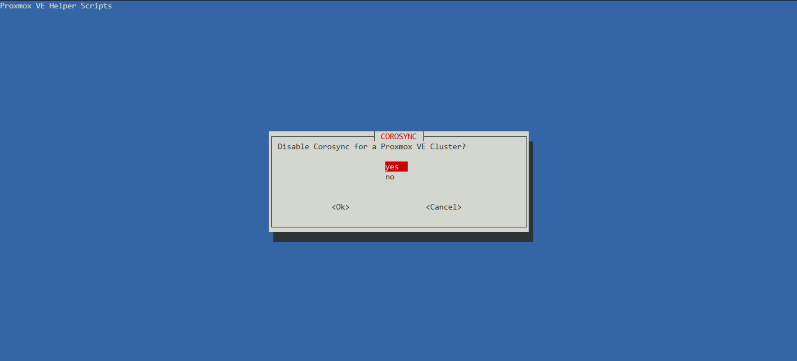

Afterwards, it’ll ask you if you want to update/reboot. Once that’s finished, you've completed setting up Proxmox VE.
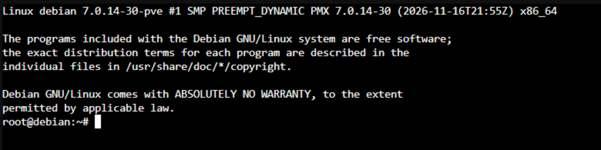

From here on out you can configure VMs and Containers to suit any personal/homelab needs. In another article I will show my setup for Tailscale so I can access my machine from anywhere in the world.
