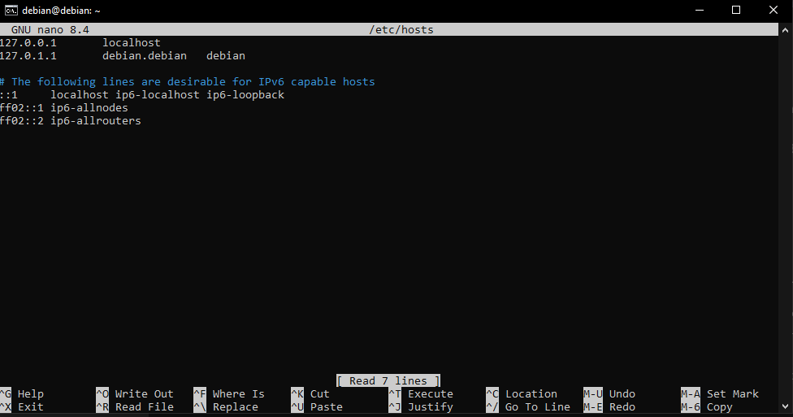

# Homelab-setup
For this setup; I'm repurposing an old Dell Desktop into a Debian server that'll host Proxmox VE.

Proxmox VE is a free, open-source platform that can run and manage Virtual Machines (VMs) and Containers. You can access it via Web-browser, so I can build from my home computer. For my project, I'm planning to use VMs to simulate a small-scale network for Cybersecurity testing. Additionally, I'll use a container to host tailscale so I can SSH into my machine if I'm away from home.

## Proxmox-setup
After installing Debian onto my host machine, I'll be referring to Proxmox documentation for setup: https://pve.proxmox.com/wiki/Install_Proxmox_VE_on_Debian_13_Trixie

Luckily the setup is straightforward, you can just copy and paste the commands into your terminal.

The first step is to change my host machine's loopback address. Here I've replaced 127.0.1.1 with the IP address of my host machine.

![Step two](

